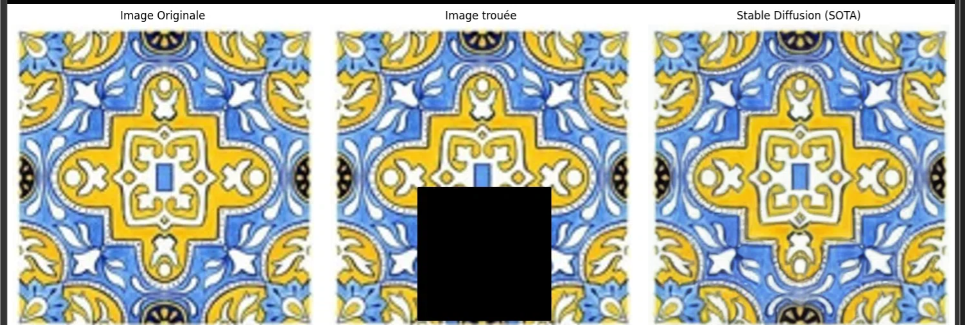
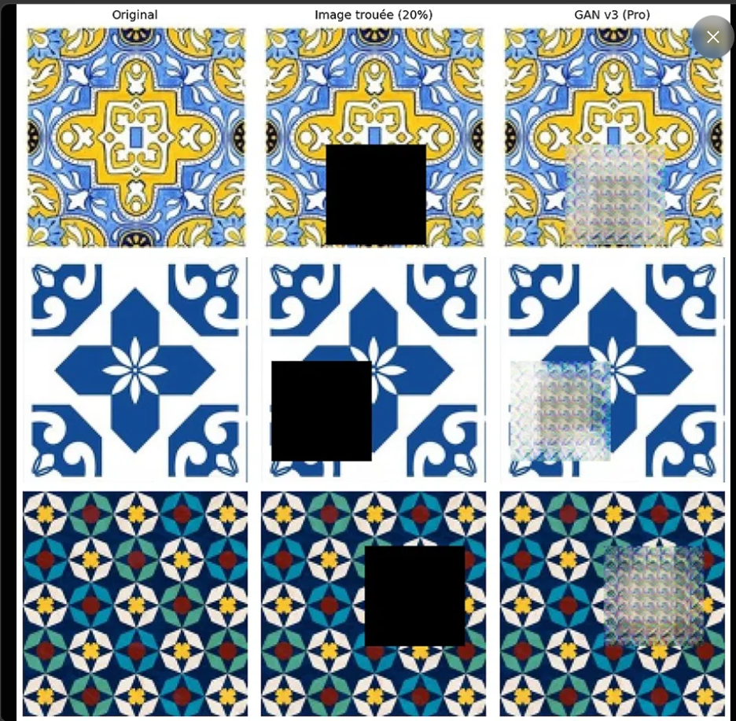

# 🕌 Restauration de Zelliges Marocains par Inpainting IA


## 📌 Présentation du Projet
Ce projet vise à restaurer automatiquement des images de **zelliges marocains** (patrimoine culturel) endommagées ou incomplètes. En utilisant des techniques d'Intelligence Artificielle Générative, le modèle est capable de "deviner" et de dessiner les motifs manquants (inpainting) en respectant la géométrie complexe et les couleurs d'origine.

## 🎯 Approches Comparées
Pour démontrer une compréhension globale du domaine, nous avons implémenté et comparé 4 approches :

1. **Baseline (OpenCV)** : Algorithme classique de Telea/Navier-Stokes.
2. **GAN from scratch** : Générateur U-Net et Discriminateur PatchGAN entraînés sur 1 500 images (avec L1 Loss + Perceptual Loss via VGG16).
3. **VQ-VAE + PixelCNN** : Compression en codes latents et génération autorégressive.
4. **Stable Diffusion Inpainting (SOTA)** : Utilisation du modèle de diffusion pré-entraîné pour un résultat indiscernable de l'original.

## 📊 Résultats
*Évaluation sur un masque de 20% sur le jeu de test (234 images).*

| Méthode | PSNR ↑ | SSIM ↑ | Qualité Visuelle |
| :--- | :---: | :---: | :--- |
| **Baseline (OpenCV)** | 18.39 | 0.811 | Flou, effet "baveux" |
| **GAN (V3)** | 17.70 | 0.800 | Artéfacts (bruit poivre et sel) |
| **VQ-VAE** | 10.88 | 0.317 | Échec visuel (bouillie) sur grands trous |
| **Stable Diffusion** | **N/A** | **N/A** | **Parfait, géométrie respectée** |

### 📸 Aperçu Visuel

**1. L'approche par GAN (From Scratch) :**
L'IA tente de reconstruire la texture mais génère des artéfacts (bruit) à cause de la taille limitée du jeu de données.


**2. L'état de l'art : Stable Diffusion (SOTA) :**
La géométrie et les couleurs sont parfaitement restaurées. Le trou est indiscernable.


## 🚀 Démonstration Interactive
Une interface web a été développée avec **Gradio**. L'utilisateur peut uploader une image de zellige, dessiner le trou avec sa souris, et l'IA complète l'image en temps réel. 
*(Exécutable directement via le notebook Colab fourni dans le dossier `notebooks/`).*

## 📂 Structure du Dépôt
```text
├── data/               # Scripts de téléchargement (Kaggle) et fiches de données
├── notebooks/          # Notebooks Colab (01_projet_complet_zellige.ipynb)
├── src/                # Code source réutilisable
│   ├── model.py        # Architecture du GAN (U-Net + PatchGAN)
│   ├── prepare_data.py # Script de téléchargement et de masquage
│   └── inference.py    # Script de génération avec Stable Diffusion
├── results/            # Figures et images de comparaison
├── requirements.txt    # Dépendances du projet
└── README.md           # Ce fichier
